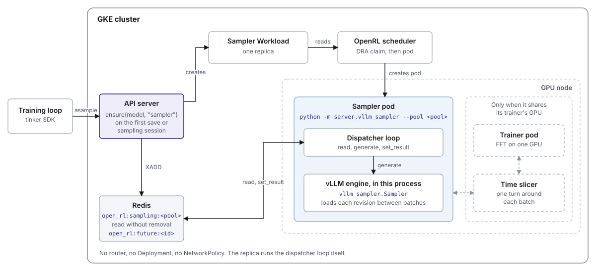

# 017: Sampling pools

**Status:** Implemented, not merged.

A sampling pool serves one model's sampling requests. The pool keeps its pending
requests in a Redis stream. A dispatcher reads the stream, gives each request to
a sampler, and saves exactly one result for each request. This replaces the old
per-model Redis list, which lost a request when the sampler that read it
stopped.

This document covers cluster mode (`OPEN_RL_WORKER_MANAGER=scheduler`). Local
mode runs every pool as one in-process sampler.

## Current architecture on main

- `save_weights_for_sampler` or `create_sampling_session` calls
  `ensure(model, "sampler")`. The API server creates a sampler Workload, and
  the scheduler creates its pod.
- The pod runs `python -m server.vllm_sampler --model-id <runtime>`, with vLLM
  in its own process. When vLLM is up, it writes
  `open_rl:sampler_ready:<runtime>`. `create_sampling_session` waits for that
  key for up to 300 seconds.
- `asample` pushes each request onto `open_rl:sampler_queue:<model_id>`. An FFT
  request names a weights path. A LoRA request names the adapter's working
  directory, `<tmp>/peft/<id>/<id>`.
- The sampler waits for one request with `BLPOP`, then pops the rest of the
  list. It groups the batch by weights path, loads new weights between groups,
  and writes each result to `open_rl:future:<request_id>`.
- An FFT sampler on its trainer's GPU takes one time-slicer turn around each
  batch it pops.

Sampling pools close four gaps in that design:

| On main | With sampling pools |
| --- | --- |
| A request leaves Redis when it is popped. A sampler that stops mid-batch loses the batch, and the client waits until its own timeout. | The dispatcher reads without removing, and deletes an entry only when its result is saved. |
| Every sampler of a model pops the same list, so nothing picks a replica by prefix cache or load. | A routed pool picks a replica with the llm-d EPP. |
| `create_sampling_session` blocks for up to 300 seconds while the sampler starts. | `asample` adds to the stream and returns. |
| A LoRA request reads the adapter's working directory, which the next save overwrites. | Each save is a frozen snapshot with its own name. |

## Two pool shapes

A replica is one process that runs vLLM. A pool is in process or routed.

| Shape | What runs | Sampler |
| --- | --- | --- |
| In process | One pod with vLLM in its own process. That process also runs the dispatcher loop. | `vllm_sampler.Sampler` |
| Routed | N `vllm serve` pods, plus one CPU pod with the dispatcher, Envoy, and the llm-d EPP. | `HttpSampler` |

A pool that LoRA jobs share is always routed, even with one replica. Each
job's `sampler_replicas` (`openrl.sampler_replicas`, default 1) is a hint, and
the pool grows to the largest one any of its jobs asks for. A job's `ensure`
only adds replicas, so the pool does not shrink until every job leaves.
Placement is best effort. A replica the cluster has no GPU for stays pending,
and the pool serves with the replicas it has.

A pool that one job owns is in process with one replica and routed with two or
more, since a router only spreads requests across replicas. An FFT sampler that
shares its trainer's GPU always has one replica.

Sampler growth can take GPUs that trainers need. To keep the roles apart, label
node pools with `openrl.io/trainer=true` or `openrl.io/sampler=true`. A node
with neither label accepts both roles. A node with either label accepts only
the roles set to `true`. Set these as node-pool labels, because a label from
`kubectl label` is lost when a node is recreated.

### In process

### Routed

The scheduler labels each replica pod with `app.kubernetes.io/component=sampler`
and `app.kubernetes.io/instance=<pool>`. The EPP runs with
`--endpoint-selector` set to the same labels and watches those pods itself, so
it needs no registry.

### Why no InferencePool

The EPP runs standalone in each pool's dispatcher pod. Its endpoint selector is
the label selector an InferencePool would hold. It needs no Gateway API or
inference-extension CRDs, no Gateway controller, and no gateway object for each
pool. Pools come and go with their jobs, and their traffic stays inside the
cluster. A pool can move to an InferencePool if a shared gateway is wanted.

## What creates what

`save_weights_for_sampler` and `create_sampling_session` call
`ensure(model, "sampler")`. So does the API server, every 30 seconds, for each
job with pending requests and a live session whose pool has no sampler left
(see Failures). The first call for a pool creates it. Later calls create only
what is missing.

| Job | Workloads | Other objects |
| --- | --- | --- |
| Shared LoRA, or two or more replicas | `sampler_replicas` sampler Workloads, each on a GPU of its own | A dispatcher Deployment and a NetworkPolicy, both named after the pool |
| One replica in a pool the job owns, with a GPU of its own | One sampler Workload | None |
| FFT that is not exclusive and has one trainer GPU | One sampler Workload, seated on the trainer's claim | None |

All LoRA jobs on one base model share one pool, `sampler-<base model>`. An FFT
job has a pool of its own. A request creates nothing. It is an entry in the
stream until it has a result.

## One request

1. `asample` checks that the weights exist, pins an FFT request to one
   revision, and adds the request to `open_rl:sampling:<pool>`. The entry holds
   the record, plus the job and the revision as fields of their own. It returns
   at once and does not wait for a sampler.
2. The dispatcher reads the entry without removing it, and gives it to its
   sampler.
3. The dispatcher saves the result with `set_result`. One transaction writes
   `open_rl:future:<request_id>` and deletes the stream entry.
4. The client calls `retrieve_future`. The API server waits up to 60 seconds
   for the result, then tells the client to try again. The result expires after
   300 seconds.

Each pool has one dispatcher. The dispatcher Deployment uses the `Recreate`
strategy, and an in-process pool has one replica. An eviction or a network
partition can still run two dispatchers for one pool for a while.
`set_result`'s transaction keeps each request to one result either way. A
restarted dispatcher reads the whole stream again, so an entry that a stopped
sampler never answered is sent again. Each request runs one or more times and
gets exactly one result. A request with no result after
`OPEN_RL_SAMPLE_DEADLINE_SECONDS` (default 3600, one hour) fails.

## The dispatcher loop

`Dispatcher` in `server/sampling_dispatcher.py` runs a pass when a new entry
arrives, or after one second. Each pass does these steps:

1. Read new entries. Drop the entries it holds whose result the API server
   saved, with one pipelined `EXISTS` on their result keys.
2. Fail entries older than the deadline.
3. Change revision once no pending entry names the current one, so every entry
   for it finishes first. The new revision is the one the oldest pending entry
   names.
4. If the current revision's directory is gone, fail its entries and send
   nothing this pass. Otherwise call `sampler.ensure_weights(revision)`. If it
   returns false, send nothing this pass. If it raises `RevisionUnloadable`,
   fail the revision's entries.
5. Call `sampler.generate(record)` for the entries the current revision still
   sends, up to 256 at a time, one from each job in
   turn. A result of None sends the entry again later.

`HttpSampler` writes the pool's revision file and starts a weight load on each
replica that does not hold the revision. A replica is ready only when its
`/weight_info` equals the revision file, and the EPP routes only to ready
replicas. After each answer, `HttpSampler` checks the version of the replica
that answered, which Envoy names in `x-openrl-upstream`, and returns None on a
mismatch. The check tries up to three times on a connection error or a timeout,
and a finished answer is thrown away only on a mismatch or when every try
failed. It also returns None on a 404, since a replica's view of the shared
volume may not show a just-frozen LoRA snapshot yet.

A weight load pauses the replica, updates its weights, resets its prefix cache,
and only then finishes the update with the revision as its version. So a
replica never reports a revision while its prefix cache still holds the old
weights' entries. A reset that vLLM refuses three times forgets the weights.
The replica then reports `unknown` until a full load replaces them.

The first time `HttpSampler` sees a replica, it closes any weight update that
an earlier dispatcher left open and resumes the replica if it was left paused.
This check runs as a task of its own for each replica, so a wedged replica does
not hold up the pass. Until its check finishes, the replica gets no load and is
not counted. A check that fails runs again on a later pass.

`vllm_sampler.Sampler` loads the revision into its own engine between batches,
so every answer in a batch comes from one revision. It calls the engine
directly. A request the engine refuses as a client error, such as a prompt
longer than `max_model_len` or a token out of the vocabulary, fails at once. On
a shared GPU each retry would take a turn from the trainer.

Both samplers build their vLLM settings with `engine_args`, their sampling
params with `sample_params`, and their results with `sample_result`.

### Revision switching

A pool serves one revision at a time, and only FFT pools switch. A LoRA request
names its adapter as the model and leaves the revision empty. An FFT pool
belongs to one job, so the revisions it switches between are that job's own
saves. The pool switches once no pending entry names the current revision, so
a client that samples an old revision while its new one waits is bounded by the
rollouts it already started. This also covers a sparse delta, which the pool
can never load again once it moves past it. Every pending entry for it is
served first, and an entry for it that arrives after the switch fails if no
replica can load the delta.

A sparse delta applies only on the saves its metadata lists. When every replica
answers, none holds the revision or a save it applies on, and no load is under
way, the sampler raises `RevisionUnloadable`. A replica that does not answer
may hold the revision, so `HttpSampler` waits for it. An older delta after a newer revision
loaded is the usual case. The dispatcher fails that revision's entries at once,
saying full weights must be saved to sample it, and the pool moves on.

### Multiple jobs on one pool

A shared LoRA pool serves every job on its base model. `asample` writes the
job's model id into each entry. The dispatcher sends one entry from each job in
turn, oldest first within a job, and starts with the job it served longest ago.
One job's big batch cannot hold up the others.

## Weights

An FFT pool serves one revision at a time. A revision is an immutable directory
of weights on the shared volume. The trainer writes `metadata.json` last. A
revision can be a delta that applies only to the saves its metadata lists. A
sampler that holds none of those saves cannot load the delta, and the delta's
requests fail.

A LoRA request names a frozen snapshot of its adapter instead of a revision.
Each save is a new snapshot with its own name, so a LoRA pool never changes
revision and never loads weights.

## Time slicing

Only an in-process sampler on its trainer's GPU takes turns. For each batch it
acquires the GPU from the node's time slicer and wakes vLLM. Then it reads the
stream again, so requests that arrived during the wait join the batch. It
answers the batch, puts vLLM to sleep, and releases the GPU. The time slicer
then moves the process's GPU memory to the host and gives the GPU to the
trainer, which takes its own turns the same way.

The process that uses the GPU is the only one that talks to the time slicer.
The dispatcher pod and the router never know that a GPU is shared, and the
slicer protocol does not change.

The process exits with an error, and Kubernetes restarts the pod, in each of
these cases:

- The vLLM engine died.
- A weight update stopped partway.
- The time slicer could not move the process's memory off the GPU. The
  process still holds the GPU, so exiting is how it gives the GPU back.

## Failures

These requests fail at once:

- An `asample` for weights that do not exist. It returns a 400.
- A request that vLLM rejects. A routed pool sees a 400 or 422, and an
  in-process sampler sees a client error. A 404, or a not-found error in
  process, is sent again until the deadline.
- A request for a revision that retention deleted, before or after the pool
  switched to it.
- A request for a revision that no replica can load.

A request waits up to the deadline, then fails, while its pool's replicas are
starting, cannot be placed, or crash-loop.

A pool that is gone comes back within 30 seconds when a live job has pending
requests in it. A pool is gone when no sampler Workload is left, or when a
routed pool has lost its dispatcher Deployment. A client that only polls `retrieve_future`
still gets its pool back. Every 30 seconds the API server finds the jobs with
pending requests in each pool stream. It reads each entry's `job` field, 100
entries at a time, and does not decode the record with its prompt. Entries
written before the stream had that field decode the record instead. It
reconciles the jobs concurrently, since an `ensure` can wait minutes for an old
pool to terminate. A job that `delete_model` completed has its pending
requests failed. Otherwise the API server acts only on a job whose pool is
gone:

- If the job's owner has a live session, the API server calls
  `ensure(job, "sampler")`.
- If the owner has no live session, the API server fails the job's pending
  requests, so a later pool on the same base model does not replay them.

A pool that is up keeps serving its requests, with or without a session. The API server holds the owner lock that the reaper takes, so the
reaper cannot release the owner between the checks and the `ensure`.

`delete_model` takes the same owner lock. Under it, the API server marks the
job completed, fails the job's pending requests, and releases its workers. The
reconcile reads the job's status again under the lock, so it never brings back
a pool for a job that was just deleted.

On the same interval, in a task of its own, the API server fails each stream
entry older than the deadline. So a request fails even when no dispatcher is
left to fail it, and a reconcile stuck in an `ensure` does not hold up the
sweep. It reads 100 entries at a time, so a backlog of long prompts never sits
in its memory at once. The trainer's retention reads the revisions that pending
requests pin the same way, from each entry's `revision` field.

## Teardown

The client sends a heartbeat every 10 seconds, and the session key expires
after 120 seconds. Every 30 seconds the reaper calls `release_owner` for each
owner that no live session uses. It deletes the pool's NetworkPolicy and
dispatcher Deployment, if the pool has them, and then every Workload of the
owner. It finds the NetworkPolicy and Deployment through the pool's Workloads
and by their `openrl.io/owner` label, so they are deleted even after the
Workloads are gone. The scheduler's finalizer deletes each pod, then frees its claim.

An FFT job is its own owner. Shared LoRA workers belong to their base model, so
the reaper releases them only when no session uses any job on that base model.
No worker or pool has an idle timeout.

## Seams

| Seam | Contract | To swap it |
| --- | --- | --- |
| Router | The dispatcher posts `/inference/v1/generate` to one URL. Replicas are found by pod labels and are ready by `/weight_info`. | Run another router in the dispatcher pod, after the version check stops using `x-openrl-upstream`. |
| Sampler | `ensure_weights(revision)`, which raises `RevisionUnloadable` for weights it can never load, and `generate(record)` | Write one class, for example for SGLang. |
| Engine settings | `engine_args` | Change one function. |
| Placement | `ensure` and `release` on a worker manager | Write another worker manager. |
| GPU sharing | The in-process sampler runs its batches through `TimeSlicedDispatcher` | Use the plain `Dispatcher`. |
| Store | Accept, read pending, and `set_result` | Write one class. |

## Open items

- `HttpSampler` finds the replica that answered from `x-openrl-upstream`, which
  only Envoy adds. Another router needs the replica to report its own version.
- No unit test runs `vllm_sampler.Sampler` with a real engine, because vLLM
  needs a GPU. It is tested on GKE.
- `retrieve_future` tells the client to try again without saying what state
  the pool is in.
- A pool's replicas can land on different GPU types, since placement asks only
  for memory. Pinning later replicas to the first replica's product is a
  follow-up.
