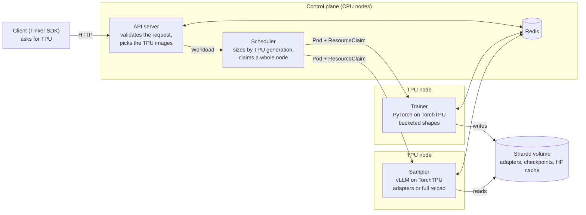

# TPU support

**Status:** Implemented on `feat/tpu`
**Author:** Hoda Mohammadi
**Last updated:** 2026-11-03

## 1. Summary

OpenRL runs its trainer and sampler workers on Cloud TPU nodes. The trainer is the existing PyTorch trainer (Hugging Face
`transformers` and `peft`) on TorchTPU, Google's native PyTorch backend for
TPU. The sampler is the existing vLLM sampler on vllm-torchtpu, vLLM's TPU
platform on the same TorchTPU. Both read and write the same Hugging Face files
as on GPU: PEFT adapter directories for LoRA, safetensors checkpoints for full
fine-tuning. No weight format is converted.

A client asks for TPU with a preference on the model, and the API server and
the scheduler do the rest: the API server builds the worker from a TPU image
and the scheduler places it on a TPU node through the Kubernetes DRA driver
for TPUs. GPU code paths are unchanged, and a cluster can hold GPU and TPU
nodes under one deployment.

What runs: shared and exclusive LoRA, and exclusive full fine-tuning. Each
worker uses one chip. See [OpenRL on GKE TPU nodes](../setup/tpu-on-gke.md)
for the setup on GKE.

## 2. Overview

The design rests on three ideas:

- **The accelerator is a property of the model, chosen by the client.** It
  is set when the model is created and never changes. Everything downstream,
  from the worker image to the node the pod lands on, follows from it. A model
  that says nothing runs on GPU.
- **TPU is a second accelerator type in the scheduler, not a second
  scheduler.** The same Workload, the same placement controller and the same
  DRA machinery serve both. What TPU adds is a driver, a way to know how much
  memory a chip has, and a rule that a worker takes a whole node.
- **The workers are the GPU workers.** The trainer and the sampler run the
  same code on a different PyTorch backend. The TPU-specific parts are small
  and sit at the edges: how the device is opened, how batches are shaped so
  the compiler is not invoked per step, and how a full model reload is done on
  a platform that stores weights differently.

## 3. Choosing an accelerator

A model carries an accelerator setting per role, trainer and sampler, with
GPU as the default. The client passes them as model settings, like the other
OpenRL settings.

Two combinations are refused when the model is created, because they cannot
work:

- **Full fine-tuning on TPU that is not exclusive.** A shared FFT worker on
  GPU is parked by the time slicer between its turns. Nothing can park a TPU
  worker, so an FFT model on TPU must own its chips.
- **The automodel trainer backend on TPU.** It is a CUDA trainer. A job's own
  trainer image is allowed, on the assumption that it brings TorchTPU.

Two consequences follow from the preference without the client asking:

- An FFT model whose sampler is on TPU syncs weights as full checkpoints,
  never as sparse deltas (section 7 says why).
- An exclusive trainer keeps its optimizer state on the chip rather than
  offloading it to the host, so every TPU FFT trainer does.

**Shared runtimes stay on one kind of accelerator.** LoRA jobs on the same
base model share a trainer and a sampler. A TPU job must not join a GPU
runtime, so the runtime identity includes the accelerator when it is TPU. TPU
and GPU jobs on one base model therefore get separate workers and separate
sampling pools, and a GPU trainer never serves an adapter a TPU sampler reads.

## 4. Placement

The scheduler already placed GPU workers by reading the DRA driver's device
inventory, estimating each worker's memory, and building a ResourceClaim that
asks for devices of the right size. TPU reuses all of it and adds four things.

**A second driver.** The scheduler reads the TPU DRA driver's inventory next
to the GPU driver's and tags every enrolled node with the type of the driver
that describes it. A TPU request is matched only against TPU nodes and a GPU
request only against GPU nodes. Role labels (trainer-only, sampler-only
nodes) work the same for both.

**Memory by generation.** The TPU driver publishes no memory capacity, so the
chip size cannot be read from the inventory. TPU memory is fixed per
generation, so the scheduler keeps a small table from the generation attribute
the driver does publish to the HBM of one chip, and uses it both to size the
worker and to build the claim's selector. If the driver starts publishing
memory capacity, the scheduler uses that instead of the table.

**A whole node per worker.** The TPU driver prepares claims for all chips of
a node or none. The claim the scheduler builds for a TPU worker therefore asks
for every chip on a node of the chosen generation, and the worker uses the
first chip. This leaves chips idle on multi-chip hosts, and it is a
limitation to address when multi-host workers are built. For now it gives
deterministic placement: a worker that finds no free node waits in the
Kubernetes queue instead of starting and colliding with another process at
runtime initialisation, which is what happens when chips are shared without a
record of who holds which.

**No sharing.** Shared claims, seats and the time-slice ledger exist so FFT
workers can take turns on a GPU. Every TPU worker is exclusive, LoRA by
construction and FFT by the rule above, so each gets a claim of its own and
time slicing is switched off on its pods.

**Fit and waiting.** A worker must fit one chip; there is no multi-chip
placement. When nothing fits, or no enrolled node of the type exists, the
Workload stays pending with the reason, and the release deployments set no
placement deadline. A model that asks for TPU on a cluster whose TPU pool is
scaled to zero waits for the pool rather than failing.

**Host memory** is sized as on GPU, parameters times a per-kind figure plus a
per-role overhead, with the limit equal to the request. The TPU overheads were
measured rather than derived, because the hosts differ from GPU hosts in what
they hold: the trainer's resident memory grows slowly over a run, and
the sampler's working set is mostly checkpoint page cache.

## 5. Worker pods

The TPU pod template is similar to the GPU one, with a few substitutions: a TPU image per role, the TPU node taint tolerated, the device
named for the trainer, and more shared memory for the sampler. Per-cluster
knobs (the sampler's maximum sequence length and batch size, the trainer's
token budget) come from a ConfigMap the operator names, applied to TPU pods
only, so the same API server serves GPU and TPU pods with different settings.

The sampler is started the same way as on GPU: vLLM inside the sampler
process when one job owns the pool, a `vllm serve` replica behind the
dispatcher when a pool is shared or has several replicas. The same sampler
image is used in both cases, and for LoRA and full fine-tuning jobs alike.

## 6. Trainer

The training algorithm, the loss functions, the optimizer, the adapter
lifecycle and the checkpoint writer are shared with GPU. TPU adds three things.

**One device seam.** The worker resolves its device once, at start, and the
TPU backend is chosen only when asked for; it is never picked automatically.
Everything after that point is written against `torch.device`, which is what
keeps the trainer one code base and leaves room for a multi-chip worker later.

**Shape bucketing.** TorchTPU compiles a program per distinct batch shape, and
each compile costs on the order of a minute. RL batches have arbitrary shapes,
so without intervention every step compiled. On TPU the trainer pads each
batch to power-of-two lengths and row counts, with a floor so tiny batches do
not fragment into many shapes, and fills the padding with zero-weight rows.
The loss is a weighted sum over unmasked tokens, so the result is identical;
only the shape set is bounded. After the first few steps nothing recompiles,
and switching adapters does not either, since the compiled program is shared
across them.

**Host allocator.** The TPU runtime runs many host threads, and under the
default allocator the trainer's resident memory grew every step. The trainer
image preloads tcmalloc, which halves the growth; the rest is what the
measured host sizing covers.

## 7. Sampler

The sampler, the dispatcher and the serve entry point are the GPU code. The
TPU platform is detected at engine start and changes a few engine options
(no CUDA-graph capture list, a worker extension for full fine-tuning).

**Start-up compiles a ladder.** Where the trainer compiles shapes as it meets
them, the TPU platform compiles a full ladder of batch and sequence shapes up
to the configured maximums before serving, and a LoRA engine compiles the
adapter kernels' shapes as well. Start-up takes minutes and generation then
runs without compile pauses. The ladder's size is the operator's main knob,
and sampling requests wait in the pool while the sampler starts rather than
failing.

**LoRA is unchanged.** Adapters are plain PEFT directories on the shared
volume, loaded through vLLM's LoRA request path, in-process or at run time on
a serve replica. The multi-LoRA implementation itself lives in vllm-torchtpu.

**Full fine-tuning reloads in place.** After each optimizer step the sampler
must take the whole updated model. Three properties of the TPU platform shape
how:

1. Its worker lacks the weight-update entry points the GPU worker has, and the
   cache reset the sampler calls afterwards. A small extension, mixed into the
   worker through vLLM's extension hook, supplies them, and routes the update
   to the same delta-snapshot transfer engine the GPU sampler uses. It is
   inert on a model without TPU-specific layout.
2. Once loaded, the platform stores each linear weight transposed and marks
   the layer as flipped. A reload rebuilds the weight in checkpoint layout, and
   the platform transposes it again only if the mark is clear. The reload
   therefore clears the mark on every such layer first and checks afterwards
   that each was set again, so a layer the checkpoint missed fails the update
   rather than serving a weight in the wrong layout. Parameters keep their
   storage, so nothing recompiles.
3. Sparse deltas are indexed in checkpoint layout and cannot patch transposed
   weights, which is why an FFT model with a TPU sampler always syncs full
   checkpoints (section 3).

With time slicing off there is no sleep mode and no turn-taking: the trainer
and the sampler of an FFT job are on separate nodes and run concurrently,
with the reload as the only coupling.

## 8. Packaging

TorchTPU and vllm-torchtpu are ordinary PyPI dependencies, in two extras: one
for the trainer, one for the sampler. They cannot share an environment with
each other or with the GPU extras, which is the split the repository already
had between the GPU trainer and vLLM. Each has a plain Ubuntu image with no
CUDA, and the trainer runs the same PyTorch version the sampler's vLLM pins,
so one TorchTPU build serves both roles.

## 9. Deployment

One overlay adds TPU to the FFT deployment: the two TPU images on the API
server, and nothing else. The scheduler's TPU defaults are built in, the
DeviceClass comes from the TPU DRA driver, and the GPU-only DaemonSets (time
slicer, snapshot agent, metrics) select GPU nodes and place no pods on TPU
nodes. The same overlay therefore serves a TPU-only cluster and a cluster
with both kinds of node.

On a mixed cluster a model that prefers TPU runs on TPU and every other model
on GPU, TPU and GPU jobs on one base model keep separate runtimes, and a
preference no node can currently serve waits for placement rather than being
refused.

## 10. Limitations

- **Multi-chip and multi-host workers.** One chip per worker; an FFT model
  must fit one chip's HBM. A multi-chip trainer would be a gang of processes
  under FSDP, which the single device seam leaves room for.
- **Per-chip claims.** The driver can hand out chips individually in a shared
  mode, but nothing then records which pod holds which chip, so an unpinned
  pod dies at start instead of queueing. Whole-node claims until the driver
  prepares partial claims.
- **Time-sliced full fine-tuning.** The GPU time slicer checkpoints CUDA
  processes; nothing equivalent exists for the TPU runtime.
- **Delta weight sync on TPU.** Blocked by the transposed layout.
- **Local mode.** TPU workers run only through the Kubernetes scheduler.
- **TPU v7 needs a forked DRA driver.** OpenRL itself needed no change for
  v7, but the upstream TPU DRA driver does not recognise v7 hardware, so v7
  clusters run a fork that publishes one device per chip, and GKE's
  auto-repair must be off on the pool because it repairs a v7 node that
  advertises no TPU through the device plugin, which every DRA node does.
