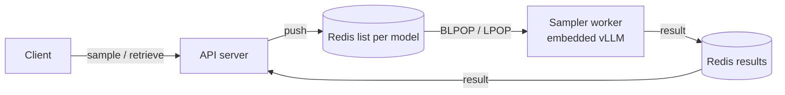
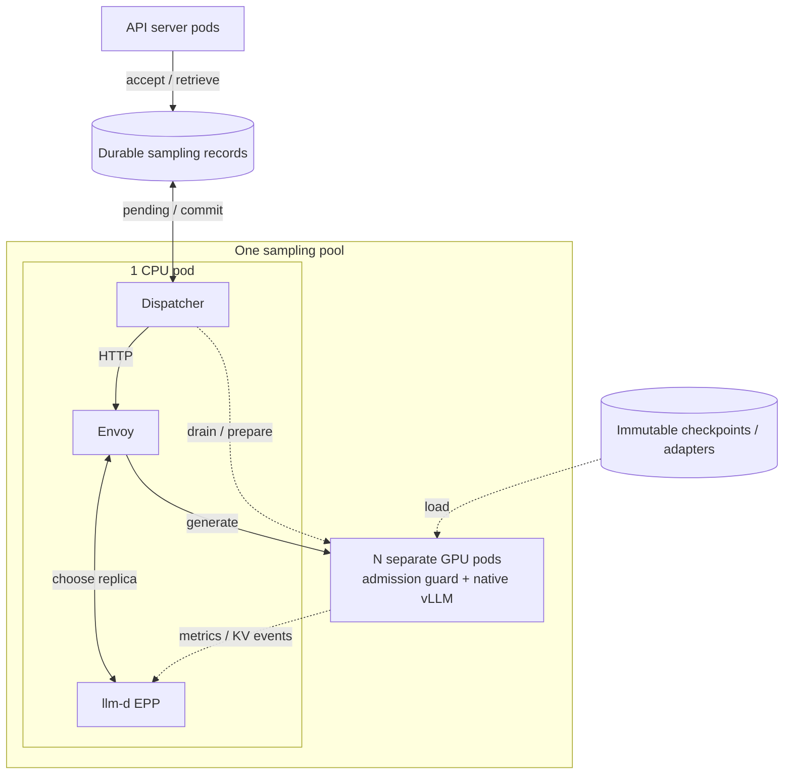

# Sampling pools for dedicated FFT and multi-LoRA

**Status:** Proposed
**Date:** 2026-10-13

## Sampling today

On main, sampling works as follows.



The API server puts each sampling request on a Redis list for its model. A
sampler worker takes all waiting requests from its list with `BLPOP` and `LPOP`.
This removes the requests from the list. The worker sends each request to its
embedded vLLM engine. Then it writes the result back to Redis, and the API server
reads the result when the client retrieves it.

One worker module, [`vllm_sampler.py`](https://github.com/gke-labs/open-rl/blob/1f08142c41b5c324f920875ed964d48875a73fc0/src/server/vllm_sampler.py), serves
both FFT and LoRA models. The workers choose their work when they take it. There
is no HTTP step between the list and vLLM. FFT samplers can use the time slicer
to share a GPU.

## Routing through llm-d

The design divides sampling into two tasks. A small CPU **dispatcher** decides
what can run. **llm-d** decides where it runs. The GPU replicas become usual
vLLM inference servers.

A **sampling pool** is one CPU pod and N GPU pods. One pool serves one FFT
training lineage, one exclusive LoRA job, or compatible jobs sharing a multi-LoRA
deployment.



A request goes through these steps:

1. The API server records the request in Redis. Then it acknowledges the request.
2. The dispatcher reads the pending request. It sends the request over HTTP to
   Envoy.
3. Envoy asks the llm-d endpoint picker (EPP) for a replica.
4. On that replica, a local admission guard checks the request. Then native vLLM
   generates the sample.
5. The dispatcher commits the result. The API server returns the result when the
   client retrieves it.

A pool can send requests to a direct endpoint instead of llm-d. This change does
not affect how the pool stores requests or manages weights.

**Store rules.** The sampling records follow four rules:

- A new request is recorded in one atomic step with an immutable model reference
  and the client's idempotency key. Only then is it acknowledged.
- The dispatcher reads pending requests without removing them.
- The first valid final result is saved, and the pending record is removed, in
  one atomic step.
- Reading a result does not remove it.

A crash or a temporary failure leaves the request pending, so the dispatcher
tries it again. Each request runs at least once and has exactly one committed
result. The design needs no durable running state and no request leases. Pending
records must not expire. Results stay for the retrieval contract. Artifacts that
pending requests need also stay.

**Redis persistence.** The store is only durable if Redis keeps its data. The
[current Redis deployment](../../k8s/deploy/base/redis.yaml) has no persistent
volume and no AOF. To survive a pod restart, Redis needs durable storage. The
store must acknowledge a request only after the persistence boundary. Redis must
not evict retained records. To survive disk loss, the storage also needs
redundancy.

**Prefix-cache routing.** Enable vLLM prefix caching. Configure llm-d for
**precise prefix-cache routing**, balanced with queue depth and KV use. llm-d has
two modes:

- The approximate mode records where it sent each prompt. It costs less, but it
  can miss evictions.
- The precise mode reads the KV events from vLLM, including resets. Its index is
  in the EPP. No separate cache database is necessary, and replicas do not
  transfer cache.

Refer to [routing modes](https://llm-d.ai/docs/0.9/architecture/advanced/kv-management/prefix-cache-aware-routing)
and the [KV indexer](https://llm-d.ai/docs/0.9/architecture/advanced/kv-management/kv-indexer).

Requests use the native `/inference/v1/generate` endpoint. This endpoint keeps
token IDs and logprobs. llm-d supports this path. It uses the token IDs in the
request and does not run a second tokenizer
([token input support](https://github.com/llm-d/llm-d-router/blob/v0.9.0/pkg/epp/framework/plugins/requestcontrol/dataproducer/tokenizer/backend.go)).

**Cache identity.** The cache identity must match the weights. For FFT, a cache
is valid for one weight revision only. Use a trusted `cache_salt` for each pool and revision. Give each LoRA
revision a unique, immutable name. Then vLLM and llm-d agree on identity. Add a
tenant scope when tenants must not share cache. Refer to
[vLLM cache keys](https://github.com/vllm-project/vllm/blob/v0.25.1/vllm/v1/core/kv_cache_utils.py)
and [llm-d identity handling](https://github.com/llm-d/llm-d-kv-cache/blob/v0.9.0/docs/architecture.md).

## FFT weight changes

Each FFT pool belongs to one training lineage. It serves one revision at a time.
To change from revision R1 to revision R2, the pool does these steps:

1. The trainer publishes R2. R2 is complete and immutable. Publication alone does
   not stop R1. The change starts when a pending request names R2.
2. The dispatcher stops new inference. It calls `drain()` on each active replica.
   Each replica closes admission. Then it completes all admitted requests,
   including the requests that wait in vLLM. If a replica does not respond, make
   sure that it stopped before you continue. A timeout is not a drain.
3. After all replicas drain, the dispatcher calls `prepare(R2)` on all replicas
   at the same time. Each replica loads the weights and clears its KV cache. It
   reports ready only when all engine ranks agree. `AllBlocksCleared` events clear
   the old llm-d index later. The local admission guard makes sure the result is
   correct.
4. Routing starts again on R2 when one replica is ready. Slower replicas stay
   closed until they are ready. Sampler GPUs stay loaded and exclusive between
   batches.

Each attempt carries the pool and revision that it expects. The local guard
checks this identity and registers admission in one atomic step. A mismatch can
be tried again. The dispatcher checks the identity that ran before it commits a
result. Thus a stale route cannot make a sample from the wrong weights.

Older pending revisions get limited, fair turns. They use retained artifacts.
`prepare` can apply sparse deltas. The exact parent must be checked, and a cold
replica must be able to build R2.

## Deployment and rollout

API server pods, durable Redis, artifact storage and trainers on separate GPUs are
shared. Each sampling pool deploys separately:

| Pods | Responsibility |
| --- | --- |
| One CPU pod, three containers | Dispatcher, Envoy and EPP. Limits concurrency and has one administrative owner. |
| N GPU sampler pods | Native vLLM and the local guard. Serves HTTP, metrics, KV events and authenticated administration. |

**Names and discovery.** Use the sampler deployment's name as the pool name:
`sampler-<existing job ID>` for FFT and exclusive LoRA, or a configured readable
name for a shared LoRA deployment. Names must satisfy Kubernetes deployment and
label-value rules, be at most 63 characters, and be unique within the namespace.
Validate them without hashing or truncation. Replica counts and weight
revisions do not change the name.

Each GPU pod has labels `app.kubernetes.io/component=sampler` and
`app.kubernetes.io/instance=<deployment name>`. Configure EPP with the namespace,
both labels, and inference port. Its native Kubernetes watcher maintains the
individual pod addresses as replicas scale or restart. Use
[`--endpoint-selector` and `--endpoint-target-ports`](https://github.com/llm-d/llm-d-router/blob/v0.11.0/cmd/epp/runner/runner.go#L372);
this mode needs no `InferencePool` resource or Redis discovery registry.

The dispatcher discovers all pods with the same selector, including unready
ones, for `prepare` and `drain`. EPP routes only to ready replicas. A new FFT
replica stays unready until it loads the selected revision. Readiness updates
can lag, so the local pool/revision admission guard remains authoritative.

A Kubernetes Service gives the router a stable address for inference. EPP
selects individual sampler pod addresses, so no additional load balancer sits
between its choice and the replica's KV cache.

**Isolation.** Each pool has a namespace, a unique pool selector and a router
endpoint. Labels establish membership; NetworkPolicies let only the CPU pod of
the pool send traffic to its samplers.
Only the dispatcher gets the administrative credentials. The three CPU containers
share one network trust boundary. Each pool authenticates pool and model access
locally. Request keys, result keys and artifact access are limited to authorized
tenants and jobs.

**FFT pools.** FFT pools have exclusive GPUs and no sampler time slicing. Set the
scheduler's [`spec.exclusive: true`](../../scheduler/docs/design.md). This
keeps the GPUs exclusive after removing sampler time-slicer integration.

**Exclusive LoRA pools.** Each exclusive LoRA job owns a separate replica group
and router, even when another job uses the same base model. GPU exclusivity alone
does not establish job isolation: these engines serve only their owning job.
Adapter saves and replica scaling keep the same pool identity.

**Multi-LoRA pools.** All replicas in a multi-LoRA pool use one exact,
compatible base revision. Adapters have immutable names and use native vLLM
resolution and residency. If an adapter is missing, the replica rejects the
request. It does not use the base weights instead. Adapter changes need no FFT
drain. The models stay correct, and the pool shares capacity on purpose. A tenant
that needs resource isolation gets a separate pool.

**Scaling and failover.** Scale the GPU replicas first. A new FFT replica loads
the selected revision before it joins. To scale in, close admission and drain.
The CPU pod readiness must not depend on GPU availability. Replace the single
dispatcher with no overlap. After a network partition, fence the old owner or
make sure that it stopped before the new one takes over. Pending requests stay
during the pause.

**llm-d without Kubernetes.** llm-d v0.9 accepts a file of vLLM IPv4 addresses
and ports instead of Kubernetes discovery:

```yaml
endpoints:
  - name: sampler-0
    address: "10.0.0.10"
    port: "8000"
  - name: sampler-1
    address: "10.0.0.11"
    port: "8000"
```

Use `file-discovery` with `watchFile: true` in the
[release-matched EPP configuration](https://github.com/llm-d/llm-d/blob/v0.9.0/guides/no-kubernetes-deployment/router/epp/config.yaml).
Envoy and the EPP forward and select requests. Metrics and KV events let the EPP
make cache-aware decisions. The file gives HTTP membership only. Precise routing
also needs KV-event subscriptions. Our deployment tools update the membership
when endpoints change. The dispatcher controls the FFT weight changes. On
Kubernetes, use the label-based discovery above. Refer to the
[static deployment guide](https://github.com/llm-d/llm-d/blob/v0.9.0/guides/no-kubernetes-deployment/README.md).

**Tests before rollout.** Test the selected llm-d release with vLLM 0.30.0 for:

- token and logprob accuracy,
- FFT cache resets,
- mixed adapters,
- crash replay.
