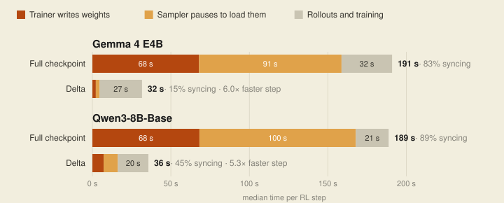
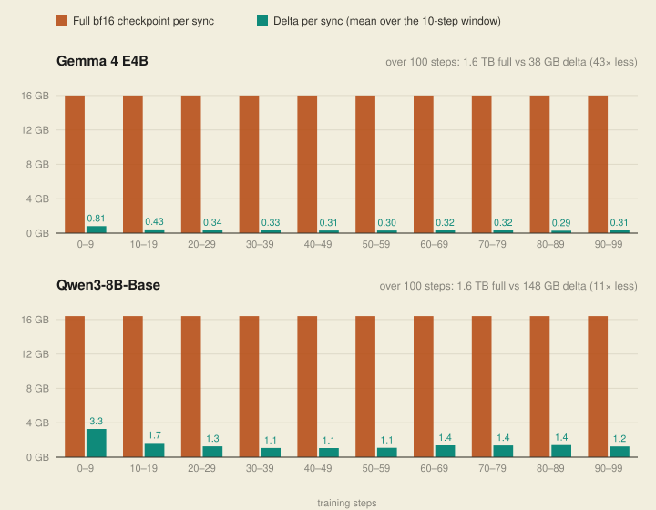
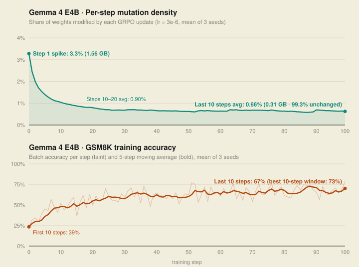
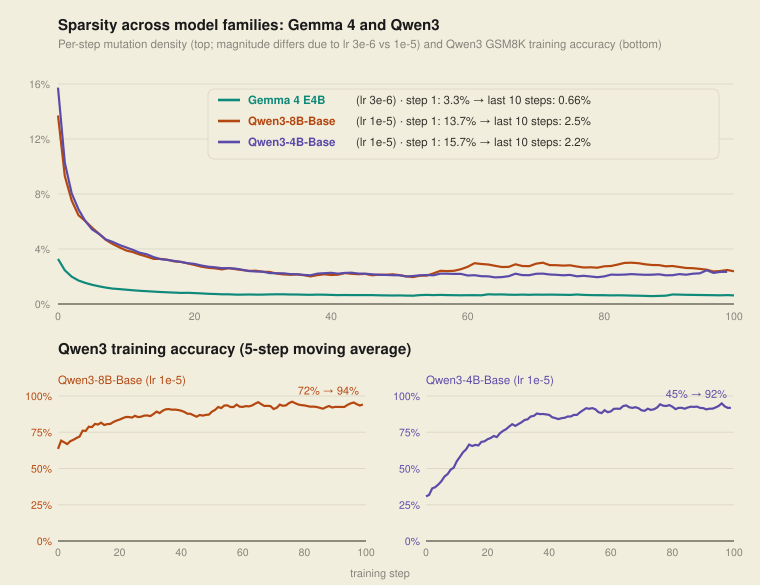

In RL post-training, the inference engine generating rollouts needs the latest policy weights after every optimizer step. OpenRL initially supported LoRA post-training, which updates only a set of adapters and makes syncing weights between the trainer and sampler lightweight. When we added full fine-tuning (FFT) support, transferring the full set of model weights after every optimizer step became one of our largest bottlenecks. This post explains how we solved that problem by syncing only the weights that actually change, as exact in-place patches applied directly by vLLM.

## The weight sync bottleneck

OpenRL runs the trainer and the sampler as separate workers across GPU nodes, exchanging weights after every step through a shared Filestore (NFS). While NFS is convenient to mount across pods, it isn't ideal for high-throughput checkpoint I/O. That didn't matter for LoRA, where each sync moves only a few hundred megabytes of adapters, but with full fine-tuning on Gemma 4 E4B, syncing the full 16 GB checkpoint [3] over Filestore takes over two and a half minutes per step (roughly 80% of total step time).

Fortunately, almost all of that transfer is redundant. Recent work shows that RL updates are naturally sparse, changing only 5–30% of parameters across a full training run [1] and roughly 1% from one step to the next [2]. Our `bf16` training runs show similar numbers (~0.7–2.5% of weights changing per step once training settles, depending on the learning rate). Instead of rewriting the full model every step, OpenRL uses delta checkpointing to sync only the weights that changed.

## How delta sync works

flowchart LR
  A["Trainer optimizer step"] --> B["Diff against the last weights sent"]
  B --> C["Write delta to shared filesystem"]
  C --> D["Sampler pauses, applies delta, resumes"]
  D --> E["Next rollouts use the new policy"]

<ol class="steps">
<li><strong>Diff.</strong> The trainer keeps a copy of the weights it last sent to the sampler in pinned host CPU memory, requiring no extra GPU VRAM. After each optimizer step, it compares the new weights against that copy bit for bit and collects the elements that changed.</li>
<li><strong>Write.</strong> It writes a delta to the shared filesystem with two pieces: which positions changed, and their new values, alongside metadata recording the modified layers and the share of weights that changed.</li>
<li><strong>Apply.</strong> When the sampler's next request needs the new version, it pauses generation, applies the delta in place, and resumes. It doesn't restart or reload the model.</li>
</ol>

**The delta format.** Each delta is a standard safetensors file (`delta.safetensors`) structured directly for vLLM's [`checkpoint_weight_patch`](https://docs.vllm.ai/en/latest/api/vllm/model_executor/model_loader/checkpoint_weight_patch/) loader: it stores a list of changed indices and their new weights for each modified layer, coming out to 6 bytes per changed weight at half-precision (`bf16`). Unchanged tensors are omitted, so any step with `<33.3%` mutation density is smaller than a full checkpoint dump.

- Because each patch stores the new parameter value rather than an additive difference, applying it reproduces the trainer's weights bit for bit, making updates idempotent and free of rounding drift over thousands of steps.
- A small `metadata.json` alongside each delta records:
  - the names and shapes of the modified weight tensors (`layer_names`, `layer_shapes`)
  - how many weights changed (`changed_elements`, `total_elements`)
  - the change density (`density_pct`) and format version (`sparse_delta` v2)

## Applying weights quickly with vLLM

On the sampler side, applying a delta means updating the changed parameters in place inside a running vLLM engine without restarting it or dropping the KV cache. We build on two vLLM primitives:

**1. Custom weight transfer backend.**
- vLLM provides a pluggable [weight transfer engine](https://docs.vllm.ai/en/latest/training/weight_transfer/base/) [4] interface that receives weight updates while generation is paused, driven through start, update, and finish hooks.
- OpenRL registers a [`delta_snapshot` backend](https://github.com/gke-labs/open-rl/blob/5fae60a5213fd05fcaf17b955f25629bbc2c0fdb/src/server/delta_weight_transfer_engine.py) enabled via `WeightTransferConfig(backend="delta_snapshot")`, avoiding a custom vLLM fork.

**2. In-place sparse patching.**
- Inside that backend, we pass the changed positions and values to vLLM's [checkpoint weight patch loader](https://docs.vllm.ai/en/latest/api/vllm/model_executor/model_loader/checkpoint_weight_patch/), indexed by the original Hugging Face parameter names.
- Even though vLLM fuses layers (such as Q, K, and V projections) and shards tensors across GPUs, the patch loader maps the Hugging Face indices to vLLM's internal serving layout and writes the updates directly into GPU memory.

Because vLLM handles the layout mapping, the same delta format works across Gemma 4 and Qwen3 without model-specific code in OpenRL. Thank you to the vLLM team for making weight transfer pluggable!

## Results: GRPO on GSM8K

We evaluated full-checkpoint sync against delta sync during full-parameter GRPO training on GSM8K using OpenRL's PyTorch trainer (8 groups of 8 rollouts per step, 512 max tokens, 100 steps, `1×H100` trainer node and `1×H100` sampler node connected via the Zonal Filestore NFS share, averaged across 3 seeds).

Because each delta transfers only a small fraction of the full checkpoint, both the trainer's NFS write and the sampler's update pause drop from over a minute to just a few seconds. Weight sync goes from dominating each RL step to a minor overhead, speeding up end-to-end training by roughly 5–6× across both Gemma 4 E4B and Qwen3-8B-Base.

<figure style="margin:1.6em 0">

<figcaption style="font-size:.92rem;color:var(--ink-faint);margin-top:.6em"><b style="color:var(--ink)">Figure 1.</b> Where an RL step's time goes with full-checkpoint sync and with delta sync over Zonal Filestore NFS. Medians per step, averaged over 3 seeds.</figcaption>
</figure>

Show the numbers

| | Gemma 4 E4B | Qwen3-8B-Base |
|---|---|---|
| Full checkpoint per sync | 16.0 GB [3] | 16.4 GB |
| Average delta per sync | 0.38 GB | 1.48 GB |
| Size reduction | 43× on average, 51× late in training | 11× on average, 13× late in training |
| Trainer write, full → delta | 67.9 s → 2.2 s | 68.2 s → 7.2 s |
| Sampler update pause, full → delta | 90.8 s → 2.4 s | 99.6 s → 9.0 s |
| Step time, full → delta | 191 s → **31.6 s** (6.0× faster) | 189 s → **35.7 s** (5.3× faster) |
| Share of step time spent syncing, full → delta | 83% → 15% | 89% → 45% |

All times are medians per step. Delta sizes count a 4-byte index and a 2-byte value per changed weight, matching the delta files on disk.

<figure style="margin:1.6em 0">

<figcaption style="font-size:.92rem;color:var(--ink-faint);margin-top:.6em"><b style="color:var(--ink)">Figure 2.</b> Bytes the sampler receives per sync over the 100-step run. Full bars show the full checkpoint; delta bars show the mean delta size in each 10-step window (6 bytes per changed weight), averaged over 3 seeds.</figcaption>
</figure>

## Mutation density over training

Every delta records its mutation density: the fraction of model weights that changed on that step. Because the trainer writes these deltas as part of weight sync, we get a step-by-step view of how the policy mutates alongside reward at no extra overhead.

<figure style="margin:1.6em 0">

<figcaption style="font-size:.92rem;color:var(--ink-faint);margin-top:.6em"><b style="color:var(--ink)">Figure 3.</b> Top: per-step mutation density on Gemma 4 E4B (<code>lr = 3e-6</code>). Bottom: GSM8K training accuracy per batch (faint) and 5-step moving average (bold) across the 100-step GRPO run, averaged over 3 seeds.</figcaption>
</figure>

### Generalizing across open-weights models and prior literature

OpenRL also supports open-weights model families such as Qwen3 (`Qwen3-8B-Base` and `Qwen3-4B-Base`), which show the same sharp step-1 spike followed by low steady-state mutation density:

<figure style="margin:1.6em 0">

<figcaption style="font-size:.92rem;color:var(--ink-faint);margin-top:.6em"><b style="color:var(--ink)">Figure 4.</b> Per-step mutation density on a shared axis (top) and Qwen3 GSM8K training accuracy (bottom) across Gemma 4 E4B (<code>lr = 3e-6</code>), Qwen3-8B-Base (<code>lr = 1e-5</code>), and Qwen3-4B-Base (<code>lr = 1e-5</code>), mean of 3 seeds.</figcaption>
</figure>

The Qwen3 curves sit higher than Gemma 4 E4B partly because they use a higher learning rate (`1e-5` vs. `3e-6`), and partly because Gemma 4 E4B's 8B total parameters include multimodal vision/audio encoders and Per-Layer Embedding lookup tables [3] that remain inactive on text-only GSM8K batches. That highlights an added benefit of delta sync on multimodal models: rather than wasting bandwidth rewriting gigabytes of frozen or inactive modality parameters on every step, unchanged tensors are skipped automatically. Across all three models, 84–97% of weights never change over the full run, consistent with prior sparsity studies [1, 2].

## Future work

<strong>Compressing deltas further for cross-cluster transfer.</strong> OpenRL's sparse safetensors format uses 6 bytes per changed weight without CPU compression overhead, which is well suited to shared cluster storage. For teams syncing weights across separate clusters or object storage over WAN links, sparse delta encoding also composes naturally with compression: Baseten recently described XORing consecutive policy checkpoints and applying a custom sparse <code>zstd</code> command-stream decoder that skips zero runs without materializing dense buffers before scattering absolute weight patches into vLLM GPU memory [5]. Adding <code>zstd</code> compression on top of sparse deltas is a natural extension when network bandwidth is more constrained than CPU decode time.

<strong>From weight deltas to built-in training observability.</strong> Because every delta explicitly captures the exact weight mutations produced by each optimizer step, delta checkpointing turns weight sync into a zero-overhead observability stream for RL training dynamics. Instead of adding custom trainer hooks or saving dense snapshots to inspect how the policy is evolving, we can directly query the deltas to see which layers mutate, when they move, and how those parameter mutations correlate with reward—which we explore in an upcoming post.

## Acknowledgements

Thank you to Hoda Mohammadi and Steve Linde for their thoughtful reviews and feedback on this post.

## References

<ol class="refs">
<li>S. Mukherjee, L. Yuan, D. Hakkani-Tür, H. Peng. <a href="https://arxiv.org/abs/2505.11711"><em>Reinforcement Learning Finetunes Small Subnetworks in Large Language Models.</em></a> arXiv:2505.11711, 2025.</li>
<li>E. Miahi, E. Belilovsky. <a href="https://arxiv.org/abs/2602.03839"><em>Understanding and Exploiting Weight Update Sparsity for Communication-Efficient Distributed RL.</em></a> arXiv:2602.03839, 2026.</li>
<li>Gemma Team. <a href="https://arxiv.org/abs/2607.02770"><em>Gemma 4 Technical Report.</em></a> arXiv:2607.02770, 2026 (Table 1: Gemma 4 E4B has 4.5B effective text parameters and 7.94B total parameters including 2.82B Per-Layer Embedding lookup parameters and multimodal encoders, totaling 16.0 GB in bf16).</li>
<li>vLLM. <a href="https://docs.vllm.ai/en/latest/training/weight_transfer/base/"><em>Weight Transfer documentation.</em></a></li>
<li>P. Stefanopoulos. <a href="https://www.baseten.co/blog/optimizing-delta-weight-syncs-for-managed-rollouts/#what-is-a-delta-weight"><em>Optimizing delta weight syncs for managed RL rollouts.</em></a> Baseten Blog, September 2026.</li>
</ol>
