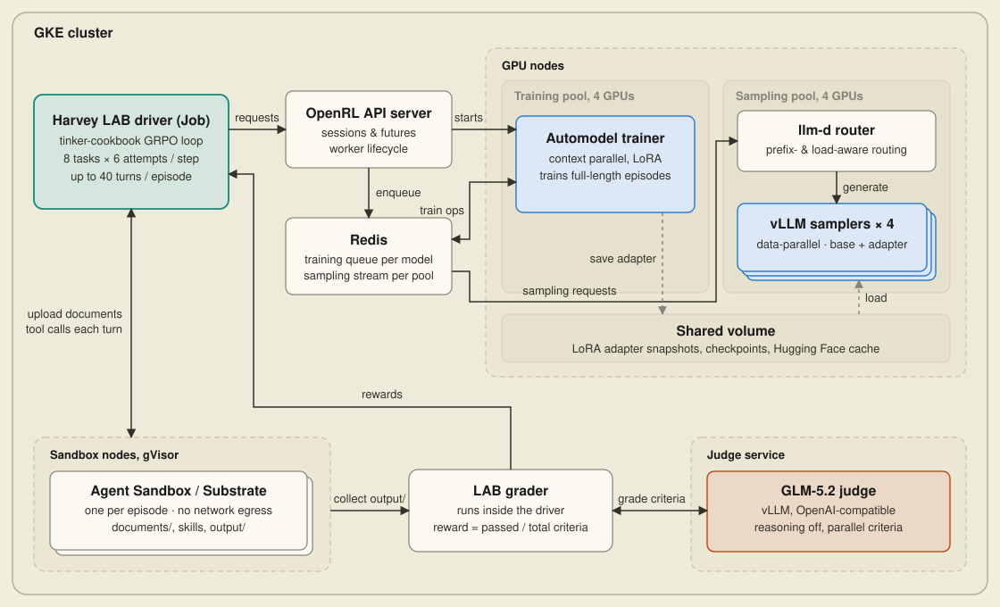
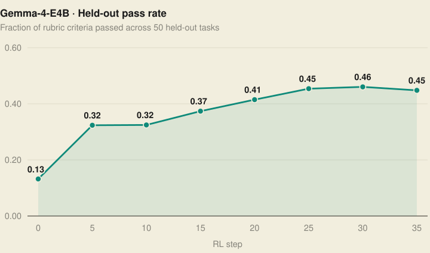
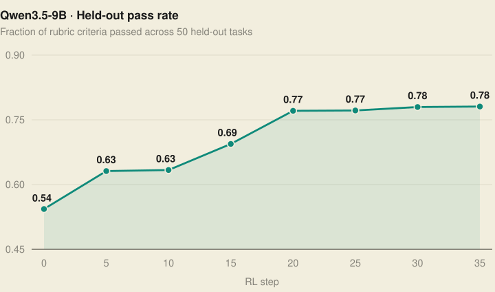
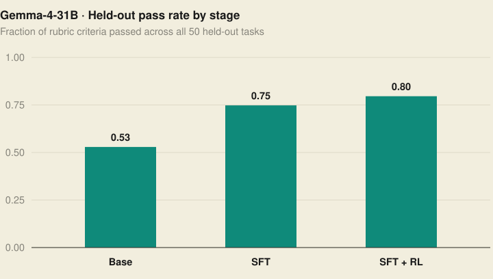

[Harvey](https://www.harvey.ai/) builds AI tools for legal work, and its open-source [Legal Agent Benchmark (LAB)](https://github.com/harveyai/harvey-labs) evaluates models on multi-step legal tasks grounded in real documents. Here we walk through our recipe for improving Gemma 4 and Qwen 3.5 on legal tasks using OpenRL, and what we learned along the way.

## Harvey's Legal Agent Benchmark

Each [LAB task](https://github.com/harveyai/harvey-labs) comes with source documents and a rubric describing the requested work. A judge model uses that rubric to score the agent's output. The benchmark spans 24 legal practice areas; [Harvey's announcement](https://www.harvey.ai/blog/introducing-harveys-legal-agent-benchmark) describes it in more detail.

For example, one [antitrust task](https://github.com/harveyai/harvey-labs/tree/main/tasks/antitrust-competition/analyze-antitrust-hsr-strategy) provides nine documents about an industrial gas distribution acquisition and asks the agent to write a risk assessment and HSR filing strategy in a Word document. Its 50 pass/fail criteria check whether the memo correctly uses facts from the source material.

## Connecting LAB to OpenRL

We built the [recipe](https://github.com/openrl-dev/openrl/tree/main/examples/harvey_labs) on [`tinker-cookbook`](https://github.com/thinking-machines-lab/tinker-cookbook)'s GRPO loop, wrapping each LAB task as a cookbook environment. That environment runs the agent's tools and returns a rubric score, while the cookbook sends sampling and training requests through OpenRL's Tinker-compatible API.

Because a model works with files and tools over many turns, a single episode can grow to hundreds of thousands of tokens. Training at that length requires context parallelism alongside model sharding, which OpenRL provides through its [Automodel](https://github.com/NVIDIA-NeMo/Automodel) training backend. Rollout generation also has to keep pace across dozens of concurrent episodes, so OpenRL scales sampling across data-parallel [vLLM](https://github.com/vllm-project/vllm) replicas.

The driver running this loop requests that trainer and sampling pool at startup. OpenRL's API server and scheduler create the GPU worker pods for the layout. The driver can run on a workstation for quick checks, or inside the same GKE cluster as a Kubernetes Job for long training runs, as shown below.

<figure style="margin:1.8em 0;width:min(1100px,calc(100vw - 48px));position:relative;left:50%;transform:translateX(-50%)">

<figcaption><strong>Figure 1.</strong> A GKE deployment of the recipe, with the driver Job and isolated sandboxes alongside OpenRL's trainer and sampler pools.</figcaption>
</figure>

Each attempt runs in an isolated sandbox initialized with the task's documents, alongside LAB's system prompt and tool definitions. The driver alternates between requesting model completions from OpenRL and executing tool calls in the sandbox. Tool output becomes part of the next prompt, so the conversation grows as the agent works.

A common sandbox interface lets the driver use local Podman containers on a workstation, or remote cluster sandboxes managed by [Agent Sandbox](https://github.com/kubernetes-sigs/agent-sandbox) or [Agent Substrate](https://github.com/agent-substrate/substrate). Because a sandbox sits idle while the model generates its next turn, any run can use Agent Substrate to suspend idle sandboxes and free their workers during generation; the next tool call resumes the sandbox with its files and processes intact.

When an attempt ends, the driver collects its deliverables and invokes LAB's grader, returning the fraction of rubric criteria passed as the reward. Files written before a turn or token limit are still graded, whereas a turn with a malformed response or tool call that the parser cannot read ends the episode ungraded.

The cookbook uses those rewards to compute each attempt's advantage relative to other attempts at the same task. As task groups finish, their trajectories and advantages stream to OpenRL's trainer, allowing LoRA updates to begin while other episodes are still running. After the update, the trainer writes an adapter snapshot to shared storage for the vLLM samplers to load before the next batch of attempts.

### Long-context training

Training on those conversations can exceed the memory of a single GPU. The recipe defaults to each model's full context window, which is roughly 260K tokens for Qwen3.5-9B and 130K for Gemma-4-E4B. In our Qwen3.5-9B runs, one H100 ran out of memory around 80K tokens.

Data parallelism alone does not reduce the memory needed for an individual sequence, since each rank still processes a complete sequence. OpenRL's Automodel training backend combines FSDP2 model sharding with context parallelism, splitting both model state and each long sequence across GPUs. The driver requests that worker layout through the client, and the cookbook continues to submit its training batches through the same API.

The backend also uses activation checkpointing to save memory by recomputing intermediate activations during the backward pass. It computes log probabilities in chunks to avoid materializing all vocabulary logits across the sequence at once.

With four context-parallel GPUs, Qwen3.5-9B trained at its full 260K-token window on four H100s (and on four B200s). Gemma-4-E4B trained at its full 130K window on four B200s, using Automodel's Gemma sharder for its sliding-window attention. The larger Gemma-4-31B ran out of memory on four H200s at 260K tokens, before fitting on four B200s at 137.4 GiB per GPU.

### Long-context sampling

Sampling dominates step time when 48 multi-turn episodes run concurrently. OpenRL's sampler system scales rollout generation using data parallelism across multiple vLLM replicas, with each replica serving a full copy of the base model and the latest LoRA adapter on its own GPU. Each run paired the four-GPU trainer with four single-GPU vLLM samplers on an eight-GPU setup (8 × H100 for the Qwen3.5-9B curve below, and 8 × B200 for the Gemma 4 runs).

Because much of the conversation is sent back to the model on every turn, OpenRL places those replicas behind the [`llm-d`](https://llm-d.ai/) router for prefix- and load-aware routing. Requests balance across the pool while steering later turns of an episode back to a replica that already holds the earlier turns in its KV cache. With four data-parallel vLLM replicas behind `llm-d`, step time in our routing comparison fell from 35 to 17.7 minutes.

## Training results

We used this recipe to run RL on Gemma 4 and Qwen 3.5, including a Gemma-4-31B run initialized from an SFT checkpoint. The split has 300 training tasks and 50 held-out evaluation tasks, with all evaluation scenario families excluded from training. LAB's grader used GLM-5.2 with reasoning disabled.

We evaluate each checkpoint against the rubric criteria for the 50 held-out tasks and report the **pass rate**: total criteria passed divided by total criteria across the evaluation set, with failed or ungraded episodes contributing zero passes.

### RL on Gemma-4-E4B and Qwen3.5-9B

  <button class="model-tab" role="tab" aria-selected="true" data-target="panel-e4b">Gemma-4-E4B</button>
  <button class="model-tab" role="tab" aria-selected="false" data-target="panel-qwen">Qwen3.5-9B</button>

<figure style="margin:1.2em 0 1.6em">

<figcaption><strong>Figure 2.</strong> Gemma-4-E4B held-out pass rate by RL step across 50 tasks, run on an 8 × B200 GKE node at its full 130K-token window.</figcaption>
</figure>

Before training, Gemma-4-E4B had a pass rate of **0.13**. Only 44% of its episodes reached grading; many ended with a malformed tool call or no output file.

RL improved both completion and deliverable quality. Malformed tool calls disappeared by the step-5 evaluation, and the share of graded episodes rose to 96–100%. Pass rate reached **0.46 at step 30** and ended at **0.45 at step 35**. Average episode length increased from 7 turns to 15.

<figure style="margin:1.2em 0 1.6em">

<figcaption><strong>Figure 2.</strong> Qwen3.5-9B held-out pass rate by RL step across 50 tasks, run on an 8 × H100 GKE node at its full 260K-token window.</figcaption>
</figure>

Qwen3.5-9B's pass rate rose from **0.54 to 0.78** over 35 RL steps.

We checked this result in a separate paired evaluation, running four attempts per task for both checkpoints under the same rules. Both checkpoints finished 97% of episodes, and pass rate rose from **0.64 to 0.77**; the paired estimate was an increase of 13.2 percentage points (95% CI: 8.4–18.1), with scores improving on **41 of the 50 tasks**.

In the traces, the trained agent read more source files before drafting, and average episode length increased from 13 turns to 19.

### SFT followed by RL on Gemma-4-31B

<figure style="margin:1.6em 0">

<figcaption><strong>Figure 3.</strong> Gemma-4-31B held-out pass rate across the 50 evaluation tasks at each training stage.</figcaption>
</figure>

Direct RL made a smaller difference on Gemma-4-31B, moving its pass rate from **0.53 to 0.55**. Its six attempts at a task were often nearly identical. When the attempts receive similar rewards, GRPO has little signal to distinguish them.

Supervised fine-tuning (SFT) on GLM-5.2 traces gave a larger improvement, raising pass rate from **0.53 to 0.75**. After SFT, the model opened roughly seven source documents per task, up from two.

The difference is visible in `teaming-agreement-term-negotiation`, a task with 28 criteria.

| | Before training · 0.39 | After SFT · 0.93 |
|---|---|---|
| Source documents | Never opens the draft agreement it is negotiating | Reads the draft agreement and both cost models |
| Deliverable preparation | Generates the document from a short outline | Writes a detailed draft, then converts and validates it twice |

Twenty RL steps after SFT brought the pass rate from **0.75 to 0.80**, cutting tool-call parse errors from four to one across the 50 evaluation tasks so 49 of the 50 episodes reached grading.

## Closing thoughts

Pushing long-horizon runs through LAB put OpenRL's control and data planes under real load and surfaced infrastructure gaps across the stack that we fixed along the way. OpenRL also fit cleanly with the rest of the open-source stack we built on, including NVIDIA's [Automodel](https://github.com/NVIDIA-NeMo/Automodel), [vLLM](https://github.com/vllm-project/vllm), the [`llm-d`](https://llm-d.ai/) router, [Agent Sandbox](https://github.com/kubernetes-sigs/agent-sandbox), [Agent Substrate](https://github.com/agent-substrate/substrate), and [`tinker-cookbook`](https://github.com/thinking-machines-lab/tinker-cookbook).

We had a lot of fun building this recipe, and we hope it serves as a blueprint for your own post-training. The [recipe README](https://github.com/openrl-dev/openrl/tree/main/examples/harvey_labs) has the setup and training commands, with instructions for evaluating a saved checkpoint. The [GKE guide](https://github.com/openrl-dev/openrl/blob/main/docs/setup/harvey-lab-on-gke.md) covers running the driver Job and sandboxes in a cluster.

## Acknowledgements

Thank you to [Harvey](https://www.harvey.ai/) for open-sourcing the Legal Agent Benchmark, and to Hoda Mohammadi, Sandeep Bajamahal, and Sunil Arora for their help and feedback on this post.
